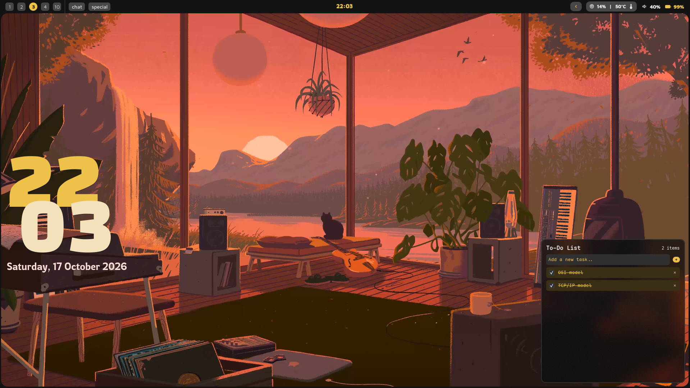
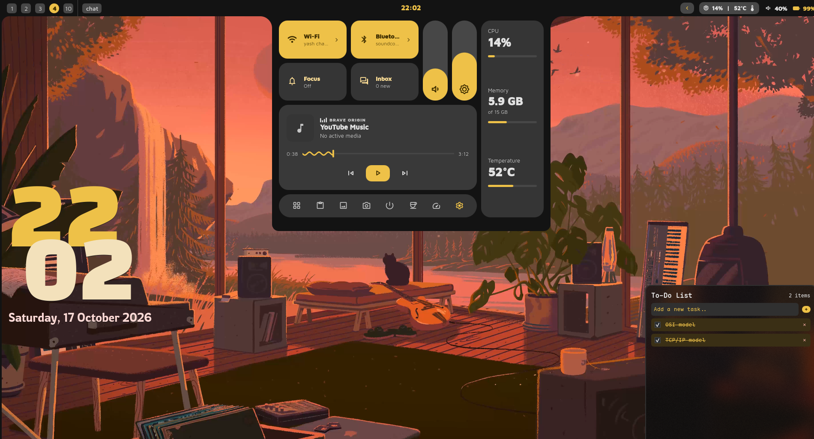
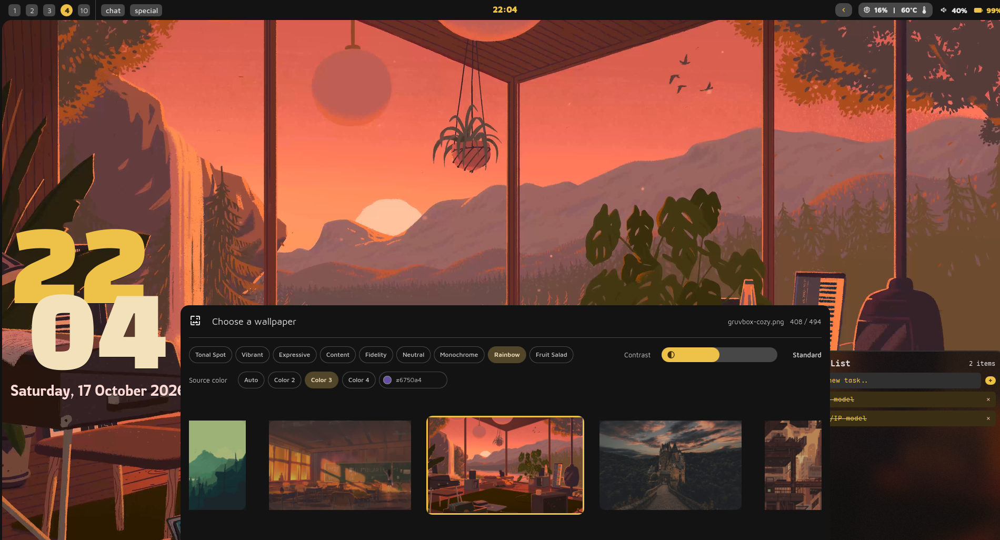

# Boom shell

A minimal shell made in quickshell for hyprland suited to my needs.

## Showcase






## Keybinds
```
Mod + Shift + W -> wallpaper picker
Mod + Shift + Q -> power menu
```

## How to install

```bash
$ git clone https://github.com/yashchaurasia667/boom_shell.git
$ cp -r ./boom_shell/* ~/.config/quickshell/
$ qs & disown
```
